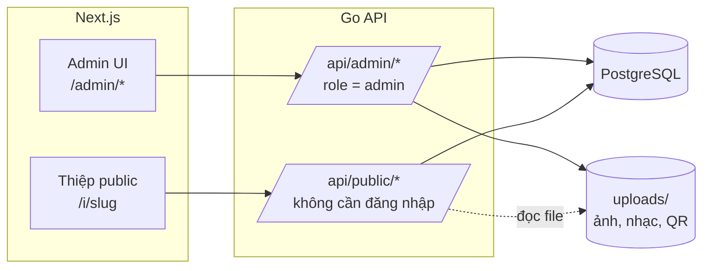
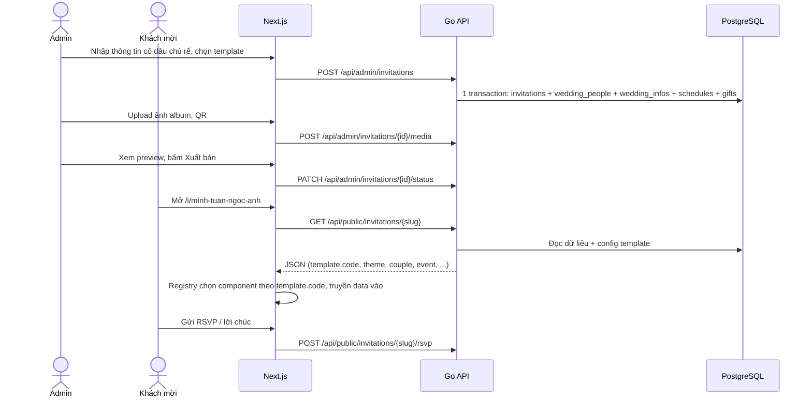

# 00. Tổng quan kiến trúc: Hệ thống thiệp cưới online

> Bộ tài liệu này mô tả phần cần xây tiếp theo, dựa trên code hiện có (auth, `tbl_users`, `tbl_roles`, `tbl_templates`, `tbl_invitations`, `tbl_rsvps`, `tbl_wishes`).

| File | Nội dung |
|---|---|
| `00-overview.md` | Tổng quan, quyết định kiến trúc, luồng dữ liệu (file này) |
| `01-database.md` | Thiết kế bảng, migration `002`, quan hệ |
| `02-api.md` | Danh sách API admin / public, input / output |
| `03-backend.md` | Cấu trúc thư mục Go, service, transaction, phân quyền |
| `04-frontend.md` | Cấu trúc Next.js, template registry, màn hình admin |
| `05-roadmap.md` | Các giai đoạn triển khai kèm checklist |

---

## 1. Mục tiêu

Chia hệ thống thành **hai hệ**:

| Hệ | Ai dùng | Làm gì |
|---|---|---|
| **Admin (back office)** | Quản trị viên | Quản lý user, quản lý template, **nhập thông tin cô dâu chú rể** để tạo thiệp, xem RSVP và lời chúc |
| **Public (thiệp)** | Khách mời | Mở link `/i/{slug}`, xem thiệp, xác nhận tham dự, gửi lời chúc |

Nguyên tắc cốt lõi: **template chỉ là giao diện, không chứa dữ liệu.** Mọi thông tin (tên, ngày giờ, địa điểm, ảnh, lịch trình, tài khoản nhận quà) nằm trong DB. Frontend lấy dữ liệu từ API rồi đưa vào template tương ứng để hiển thị.

## 2. Luồng nghiệp vụ chính

## 3. Các quyết định kiến trúc

| # | Quyết định | Lý do |
|---|---|---|
| D1 | Thông tin đám cưới lưu ở **bảng riêng, có cột rõ ràng** (không nhét hết vào JSONB) | Truy vấn, validate, sắp xếp, báo cáo dễ; đổi template không mất dữ liệu |
| D2 | `tbl_invitations.data` (JSONB) chỉ dùng cho **tùy chỉnh hiển thị** (màu, bật/tắt section) | Dữ liệu cốt lõi có cấu trúc, tùy chỉnh giao diện thì linh hoạt |
| D3 | `tbl_templates.config` (JSONB) giữ **cấu hình mặc định** của template | Thêm template mới không cần sửa schema |
| D4 | Template = React component đăng ký trong **registry** theo `template.code` | Thêm template chỉ cần thêm 1 thư mục và 1 dòng đăng ký |
| D5 | Hai nhóm route tách biệt: `/api/admin/*` (bắt buộc role admin) và `/api/public/*` (chỉ trả thiệp đã `published`) | Phân quyền rõ ràng, không lộ nhầm dữ liệu nháp |
| D6 | Ghi nội dung thiệp bằng **1 transaction** (`PUT` thay thế toàn bộ phần con) | Tránh dữ liệu nửa vời, code đơn giản |
| D7 | Thêm `service` layer cho domain `invitation` | Có logic nhiều bảng và phân quyền sở hữu, về sau user tự sửa thiệp sẽ dùng lại |
| D8 | File upload lưu local (`uploads/`) qua interface `Storage` | Bắt đầu đơn giản, sau này đổi sang S3 không sửa handler |

## 4. Cần đại ca xác nhận (em đang giả định như sau)

1. **Khách hàng là user có tài khoản.** `tbl_invitations.user_id` là chủ thiệp. Admin tạo user (role `user`) rồi tạo thiệp gán cho user đó. Nếu khách không cần tài khoản thì đổi `user_id` thành chủ thiệp là chính admin.
2. **Một user có thể có nhiều thiệp** (ví dụ thiệp nhà trai, nhà gái). Muốn giới hạn thì thêm ràng buộc.
3. **Giai đoạn đầu chỉ admin sửa nội dung thiệp.** User tự sửa là giai đoạn sau, service layer đã chừa sẵn kiểm tra quyền sở hữu.
4. **Ảnh lưu trên ổ đĩa của server** (volume docker `uploads`). Production lớn thì chuyển S3 / R2.

## 5. Ánh xạ từ code hiện tại sang thiết kế mới

| Hiện tại | Sau khi làm |
|---|---|
| Hằng số `W` trong `app/page.tsx` và `app/template/page.tsx` | Thành `InvitationData` lấy từ API; hằng số cũ chuyển thành `sampleData.ts` để preview template |
| `app/page.tsx` (mẫu hồng) | `components/invitation/templates/rose/` |
| `app/template/page.tsx` (mẫu rồng phượng) | `components/invitation/templates/dragon/` |
| `// TODO: gọi API backend` (RSVP, lời chúc) | Gọi `POST /api/public/invitations/{slug}/rsvp` và `/wishes` |
| `app/admin/page.tsx` (trang trống) | Dashboard admin có sidebar và các màn quản lý |
