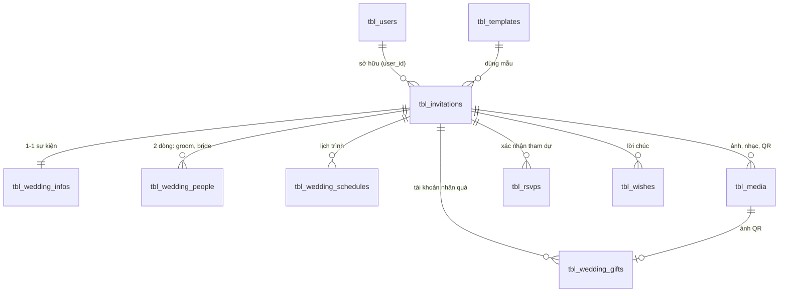

# 01. Thiết kế database

Giữ nguyên các bảng của `001_init.up.sql` (`tbl_roles`, `tbl_permissions`, `tbl_users`, `tbl_templates`, `tbl_invitations`, `tbl_rsvps`, `tbl_wishes`). Migration `002` chỉ **thêm bảng mới và chỉnh nhẹ** `tbl_invitations`.

## 1. Sơ đồ quan hệ



| Bảng | Vai trò | Ghi chú |
|---|---|---|
| `tbl_invitations` | "Vỏ" của thiệp: chủ sở hữu, template, slug, trạng thái | Đã có, chỉnh nhẹ |
| `tbl_wedding_infos` | **Thông tin sự kiện**: giờ lễ, giờ tiệc, địa điểm, dress code | Mới, quan hệ 1-1 |
| `tbl_wedding_people` | **Thông tin cô dâu và chú rể**: tên, bố mẹ, địa chỉ | Mới, đúng 2 dòng mỗi thiệp |
| `tbl_wedding_schedules` | Lịch trình trong ngày cưới | Mới |
| `tbl_wedding_gifts` | Tài khoản ngân hàng và QR nhận mừng cưới | Mới |
| `tbl_media` | File upload: ảnh album, ảnh bìa, QR, nhạc nền | Mới |

## 2. Vì sao tách bảng thay vì dùng một cột JSONB

- Validate được ở DB (`NOT NULL`, `CHECK`, `UNIQUE`).
- Truy vấn dễ: "các đám cưới tháng 1", "thiệp có RSVP chưa trả lời".
- Đổi template không ảnh hưởng dữ liệu.
- Phần **tùy chỉnh giao diện** thì không cần cấu trúc chặt, nên vẫn dùng JSONB (`tbl_invitations.data`).

## 3. Migration `002_invitation_content.up.sql`

```sql
-- ===== tbl_invitations: small adjustments =====
-- event_date is dropped: tbl_wedding_infos is the single source of truth for dates.
ALTER TABLE tbl_invitations
  DROP COLUMN IF EXISTS event_date,
  ADD COLUMN IF NOT EXISTS created_by uuid REFERENCES tbl_users(id) ON DELETE SET NULL,
  ADD COLUMN IF NOT EXISTS view_count integer NOT NULL DEFAULT 0;

-- ===== Media (created first because gifts reference it) =====
CREATE TABLE IF NOT EXISTS tbl_media (
  id            uuid PRIMARY KEY DEFAULT gen_random_uuid(),
  invitation_id uuid NOT NULL REFERENCES tbl_invitations(id) ON DELETE CASCADE,
  kind          varchar(20) NOT NULL
                CHECK (kind IN ('cover', 'photo', 'qr', 'music', 'hero')),
  storage_key   text NOT NULL,                -- e.g. 2027/01/<uuid>.jpg (relative to the upload dir)
  mime_type     varchar(100) NOT NULL,
  size_bytes    bigint NOT NULL CHECK (size_bytes > 0),
  sort_order    integer NOT NULL DEFAULT 0,
  created_at    timestamptz NOT NULL DEFAULT now()
);
CREATE INDEX IF NOT EXISTS idx_media_invitation ON tbl_media (invitation_id, kind, sort_order);

-- ===== Event info (1-1 with invitation) =====
CREATE TABLE IF NOT EXISTS tbl_wedding_infos (
  id               uuid PRIMARY KEY DEFAULT gen_random_uuid(),
  invitation_id    uuid NOT NULL UNIQUE REFERENCES tbl_invitations(id) ON DELETE CASCADE,
  ceremony_at      timestamptz NOT NULL,        -- wedding ceremony date and time
  ceremony_place   text,                         -- e.g. "Lễ thành hôn được cử hành tại tư gia"
  party_at         timestamptz,                  -- reception date and time
  venue_name       varchar(200),
  venue_address    text,
  map_url          text,                         -- optional; if empty the FE builds a Google Maps link from the address
  lunar_text       varchar(100),                 -- e.g. "Tức ngày 9 tháng 12 năm Bính Ngọ"
  dress_code       varchar(200),
  dress_colors     text[] NOT NULL DEFAULT '{}', -- hex colors, e.g. {'#F8D3DD','#FFFFFF'}
  closing_message  text,
  created_at       timestamptz NOT NULL DEFAULT now(),
  updated_at       timestamptz NOT NULL DEFAULT now()
);

-- ===== Groom and bride (exactly 2 rows per invitation) =====
CREATE TABLE IF NOT EXISTS tbl_wedding_people (
  id             uuid PRIMARY KEY DEFAULT gen_random_uuid(),
  invitation_id  uuid NOT NULL REFERENCES tbl_invitations(id) ON DELETE CASCADE,
  side           varchar(10) NOT NULL CHECK (side IN ('groom', 'bride')),
  short_name     varchar(50)  NOT NULL,          -- shown on the cover, e.g. "Minh Tuấn"
  full_name      varchar(150) NOT NULL,
  rank_label     varchar(50),                    -- e.g. "Trưởng nam", "Út nữ"
  father_name    varchar(150),
  mother_name    varchar(150),
  family_address text,
  created_at     timestamptz NOT NULL DEFAULT now(),
  updated_at     timestamptz NOT NULL DEFAULT now(),
  UNIQUE (invitation_id, side)
);

-- ===== Schedule =====
CREATE TABLE IF NOT EXISTS tbl_wedding_schedules (
  id            uuid PRIMARY KEY DEFAULT gen_random_uuid(),
  invitation_id uuid NOT NULL REFERENCES tbl_invitations(id) ON DELETE CASCADE,
  at_time       time NOT NULL,                  -- API returns it as "HH:MM"
  title         varchar(200) NOT NULL,
  sort_order    integer NOT NULL DEFAULT 0
);
CREATE INDEX IF NOT EXISTS idx_schedules_invitation ON tbl_wedding_schedules (invitation_id, sort_order);

-- ===== Gift accounts =====
CREATE TABLE IF NOT EXISTS tbl_wedding_gifts (
  id            uuid PRIMARY KEY DEFAULT gen_random_uuid(),
  invitation_id uuid NOT NULL REFERENCES tbl_invitations(id) ON DELETE CASCADE,
  side          varchar(10) NOT NULL CHECK (side IN ('groom', 'bride')),
  bank_name     varchar(100) NOT NULL,
  account_no    varchar(50)  NOT NULL,
  account_name  varchar(150) NOT NULL,
  qr_media_id   uuid REFERENCES tbl_media(id) ON DELETE SET NULL,
  sort_order    integer NOT NULL DEFAULT 0
);
CREATE INDEX IF NOT EXISTS idx_gifts_invitation ON tbl_wedding_gifts (invitation_id, sort_order);

-- ===== RSVP: add optional fields =====
ALTER TABLE tbl_rsvps
  ADD COLUMN IF NOT EXISTS phone varchar(20),
  ADD COLUMN IF NOT EXISTS note  varchar(500);

-- ===== updated_at triggers =====
DROP TRIGGER IF EXISTS trg_wedding_infos_upd ON tbl_wedding_infos;
DROP TRIGGER IF EXISTS trg_wedding_people_upd ON tbl_wedding_people;

CREATE TRIGGER trg_wedding_infos_upd
BEFORE UPDATE ON tbl_wedding_infos
FOR EACH ROW EXECUTE FUNCTION set_updated_at();

CREATE TRIGGER trg_wedding_people_upd
BEFORE UPDATE ON tbl_wedding_people
FOR EACH ROW EXECUTE FUNCTION set_updated_at();
```

### `002_invitation_content.down.sql`

```sql
DROP TABLE IF EXISTS tbl_wedding_gifts;
DROP TABLE IF EXISTS tbl_wedding_schedules;
DROP TABLE IF EXISTS tbl_wedding_people;
DROP TABLE IF EXISTS tbl_wedding_infos;
DROP TABLE IF EXISTS tbl_media;

ALTER TABLE tbl_rsvps
  DROP COLUMN IF EXISTS phone,
  DROP COLUMN IF EXISTS note;

ALTER TABLE tbl_invitations
  DROP COLUMN IF EXISTS created_by,
  DROP COLUMN IF EXISTS view_count,
  ADD COLUMN IF NOT EXISTS event_date timestamptz;
```

> Lưu ý: `001_init.up.sql` đang dùng `INSERT` seed không có `ON CONFLICT`. Nên tách phần seed sang `002` hoặc `003_seed.up.sql` như đã đề xuất ở lần review trước, để migration schema chạy lại được an toàn.

## 4. Cấu trúc JSONB

### `tbl_templates.config`: cấu hình mặc định của template

```json
{
  "theme": {
    "bg": "#4A1B2D",
    "card": "#5F2A41",
    "txt": "#F8DCE2",
    "acc": "#F2B8C6",
    "dim": "#C99AA8"
  },
  "sections": {
    "album": true,
    "countdown": true,
    "map": true,
    "schedule": true,
    "dresscode": true,
    "guestbook": true,
    "gifts": true
  }
}
```

### `tbl_invitations.data`: tùy chỉnh riêng cho từng thiệp

Chỉ chứa phần **khác** với mặc định. Backend gộp `template.config` với `invitation.data` (data ghi đè config), rồi trả về một object `theme` và `sections` đã gộp cho FE.

```json
{
  "theme": { "acc": "#E8D3A0" },
  "sections": { "countdown": false }
}
```

## 5. Quy tắc dữ liệu

| Quy tắc | Cách thực hiện |
|---|---|
| `slug` duy nhất, chỉ gồm `a-z 0-9 -`, 3-100 ký tự | `UNIQUE` ở DB, regex ở handler |
| Thiệp `published` bắt buộc có đủ `groom`, `bride` và `tbl_wedding_infos` | Service kiểm tra trước khi cho xuất bản |
| Mỗi thiệp đúng 2 dòng `tbl_wedding_people` (`groom`, `bride`) | `UNIQUE (invitation_id, side)` |
| Xóa thiệp thì xóa luôn dữ liệu con | `ON DELETE CASCADE` |
| Xóa file ảnh trên đĩa khi xóa `tbl_media` | Service gọi `Storage.Delete` (DB không tự làm được) |
| Múi giờ | Lưu `timestamptz`, API trả ISO 8601 có `+07:00`, FE hiển thị theo `Asia/Ho_Chi_Minh` |
| Xóa user | Soft delete (`deleted_at`). Thiệp của user đó giữ nguyên, admin xử lý riêng |
